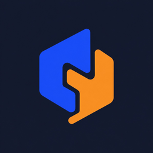

# Brand Identity

The canonical meaning of the organization logo. Design, README, website and branding
decisions follow this document. Product brands (such as the Recipely app's chef-hat logo)
are separate and keep their own identity.

## Brand Mark Meaning — Recipely Studio / Software Organization

### Core Concept

The logo represents **two independent elements coming together to form one cohesive structure**. It symbolizes collaboration, thoughtful engineering, and the creation of a shared software ecosystem by two developers.

The studio builds multiple applications, developer tools, and open-source libraries. Therefore, the mark represents the organization behind these products rather than any single application or industry.

### Symbolism

#### The Blue Form — Engineering and Structure

The deep blue shape represents technical discipline, logical thinking, architectural integrity, and reliability. It reflects the engineering foundation behind the studio's software products: well-designed systems built with care and intention.

Color: `#2747D6`

#### The Orange Form — Creativity and Craft

The warm orange shape represents creativity, experimentation, initiative, and the process of turning ideas into practical products. It complements the blue form by expressing the creative side of software development.

Color: `#F28C28`

#### The Interlocking Geometry — Collaboration and Integration

The two shapes fit together through a carefully designed geometric connection. Each retains its own identity while contributing to a unified mark.

This represents the partnership between two developers with complementary perspectives, as well as the way independent modules, layers, and components connect to form a coherent software system.

The geometry is also conceptually inspired by traditional craftsmanship, particularly the principle behind Turkish interlocking woodworking techniques such as kündekari: individual pieces are precisely shaped to fit together as part of a larger structure. The logo is an abstract, modern interpretation of this principle, not a literal reproduction of a traditional motif.

#### The Dark Navy Background — Focus and Clarity

The dark navy background provides contrast and gives the mark a calm, technical, and professional character.

Color: `#161B2E`

### Brand Philosophy

The logo expresses four central principles:

- **Independent parts, shared purpose:** Different skills and perspectives combine to achieve a common goal.
- **Architecture over improvisation:** Good software emerges from intentional structure and well-defined relationships between components.
- **Craftsmanship in engineering:** Details matter, and the way components fit together is as important as the components themselves.
- **One studio, many products:** The organization provides a common foundation for applications, libraries, tools, and future products without tying its identity to a single brand or technology.

### Brand Statement

**Two perspectives. One architecture. Many things built together.**

The mark should feel distinctive, deliberate, modern, and enduring. It should communicate a capable software studio rather than a single product, and remain recognizable at small sizes such as a GitHub organization avatar.

### Design Constraints

- Deep blue: `#2747D6`
- Warm orange: `#F28C28`
- Dark navy: `#161B2E`
- Minimal, flat, geometric forms
- No text or lettering in the symbol
- No food-specific imagery
- No unnecessary ornamentation, gradients, or 3D effects
- Must remain legible at small sizes and work as a standalone organizational avatar

## Assets

| File | Use |
|---|---|
| [`assets/logo.png`](../assets/logo.png) | 1024 px master: avatars, social previews, print |
| [`assets/logo-256.png`](../assets/logo-256.png) | READMEs and web pages |

Embed from anywhere with
`https://raw.githubusercontent.com/Recipely-Team/.github/main/assets/logo-256.png`.
